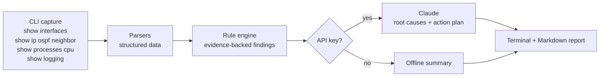

# 🤖 NetOps AI Assistant


**AI-assisted troubleshooting for Cisco networks.** Paste the output of a few `show` commands into a text file. The assistant parses it, detects problems with a rule engine, and then asks Claude to explain the **root causes in plain language**, link related problems together, and produce an **ordered action plan**, in English or Arabic.

```bash
python -m netops samples/branch-sw01.txt --lang ar --report report.md
```

---

## 🧠 How it works: rules find the problems, AI explains them



The key design decision is that **the AI never makes up findings**. Every finding comes from a deterministic rule, and each one carries its evidence: the counters and log lines it is based on. Claude receives these structured findings with a trimmed slice of the raw output, and its system prompt tells it to use only that evidence. Its job is the part rules are bad at: seeing that *CRC errors + link flaps on the same port = one physical problem*, ranking the problems by user impact, and explaining them to the engineer.

If no API key is set, or the API call fails, the tool falls back to an offline summary, so it always produces a report.

## 🔍 What it detects

| Rule | Signals used | Typical root cause it points to |
|---|---|---|
| **Duplex mismatch** | Half-duplex on a gig port, late collisions, `%CDP-4-DUPLEX_MISMATCH` | One side hard-coded, the other auto-negotiating |
| **Physical errors** | CRC ratio against input packets, reliability, correlation with flaps | Bad cable, patch port, SFP or NIC |
| **Link flapping** | Repeated `%LINK-3-UPDOWN` for the same port | An unstable link or a rebooting device |
| **OSPF adjacency** | Neighbors stuck in `EXSTART`/`EXCHANGE`/`INIT`, related `%OSPF` logs | MTU mismatch, one-way hellos, ACLs, timers or authentication |
| **High CPU** | 5s/1m/5m CPU, top processes (`IP Input`) | Process switching, a broadcast storm or L2 loop |
| **MAC flapping** | `%SW_MATM-4-MACFLAP_NOTIF` | A Layer 2 loop or a NIC teaming issue |
| **Congestion** | txload/rxload > 80%, output drops | A saturated uplink that needs QoS, an EtherChannel or an upgrade |
| **Config change** | `%SYS-5-CONFIG_I` | Change correlation: "did it start after this?" |

Interface names are normalised, so `GigabitEthernet1/0/2`, `Gi1/0/2` and `gi1/0/2` all count as the same port. That is what lets the tool connect log lines to counters.

## 📸 Example

Running it on [`samples/branch-sw01.txt`](samples/branch-sw01.txt), a branch switch with several overlapping problems:

```
╭──────────────────────────── netops 1.0.0 ─────────────────────────────╮
│ BRANCH-SW01 · health 0/100 · 4 interfaces · 3 OSPF neighbors · 12 log lines │
╰───────────────────────────────────────────────────────────────────────╯
 Severity   Finding                        Target                         Key evidence
 CRITICAL   Duplex mismatch                Gi1/0/1 (FINANCE-PC-01)        Half-duplex at 100Mb/s, 3,398 late collisions
 CRITICAL   Physical layer errors (CRC)    Gi1/0/2 (PRINTER-2F)           47,902 CRC errors (0.54%) · flapped 3 times
 CRITICAL   Link flapping                  Gi1/0/2 (PRINTER-2F)           3 down/up cycles in 50 minutes
 CRITICAL   OSPF adjacency not FULL        10.255.0.7 via Vlan100         EXSTART + "mismatched MTU" log
 CRITICAL   OSPF adjacency not FULL        10.255.0.9 via Vlan200         stuck in INIT
 CRITICAL   High CPU utilisation           BRANCH-SW01                    91% / 87% / 79%, IP Input on top
 CRITICAL   MAC address flapping           VLAN 10: Gi1/0/5 ↔ Gi1/0/6     possible Layer 2 loop
 WARNING    Link congestion                Gi1/0/24 (UPLINK-TO-CORE)      txload 91%, 88,123 output drops
 INFO       Recent configuration change    BRANCH-SW01                    by admin from 10.9.9.9
```

You can see the full generated report in [`docs/sample-report.md`](docs/sample-report.md).

## 🚀 Usage

```bash
git clone https://github.com/Moleo10/netops-ai-assistant.git
cd netops-ai-assistant
pip install -r requirements.txt

# offline (no API key needed)
python -m netops samples/branch-sw01.txt --no-ai

# with AI analysis
export ANTHROPIC_API_KEY=sk-ant-...      # see .env.example
python -m netops samples/branch-sw01.txt --report report.md
python -m netops samples/branch-sw01.txt --lang ar     # Arabic explanation

# several devices at once
python -m netops captures/*.txt --report reports/report.md
```

To collect a capture from a real device, run these commands and save the session to a `.txt` file:

```
show interfaces
show ip ospf neighbor
show processes cpu sorted
show logging
```

The exit code is `1` when critical findings exist, so you can use it in scripts and monitoring jobs.

## 🧪 Tests

```bash
pytest -q     # 19 tests
```

The tests cover the parsers, every rule, severity ordering, evidence correlation, a healthy device producing no findings (no false positives), the prompt construction, the Claude call (with an injected fake client), the fallback when the API fails, the report, and the CLI exit codes. CI runs them on Python 3.10 and 3.12.

## 📁 Structure

```
netops/
├── parsers.py   # CLI capture → Interface / OspfNeighbor / LogEntry / CPU
├── rules.py     # rule engine → Finding(severity, evidence, cause, next steps)
├── ai.py        # Claude prompt + call + offline fallback
├── report.py    # Markdown report
└── cli.py       # terminal UI
samples/         # realistic captures (problem branch switch + healthy router)
tests/
```

## 🧭 Roadmap
- [ ] Collect captures live over SSH with Netmiko (reusing [network-automation-lab](https://github.com/Moleo10/network-automation-lab))
- [ ] More rules: STP topology changes, BGP neighbors, interface error trends over time
- [ ] Web UI: paste output and get the report in the browser

---

Built by **Mohammed Saqer Almutairi** · Networking + AI · [LinkedIn](https://www.linkedin.com/in/m-saqer-almutairi)
